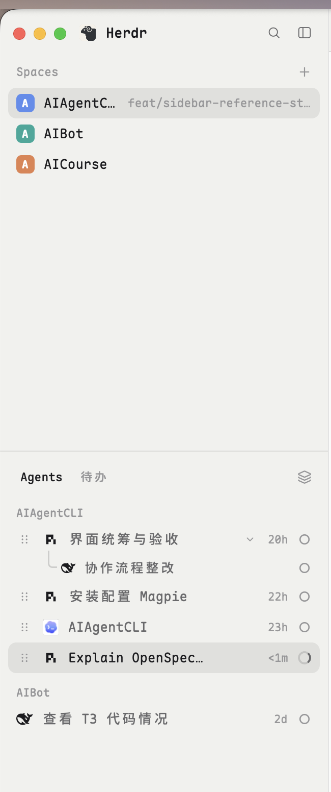

# Herdr UI Style（当前使用）

> 状态: v2.0 | 创建: 2026-11-18 | 最后更新: 2026-11-18 | 关联: layout/agents-order.json, tokens/

这个仓库记录 **Herdr 当前实际启用的界面风格**：

- 布局：`agents-order`（当前 active layout）
- 主题：未显式指定 → 按外观使用内置 `paper`（浅色）/ `graphite`（深色）；当前外壳 `appearance: "light"`
- 字体：Maple Mono NF CN（UI + 终端，连字关闭，`font_size: 15`）
- 外壳：内置 `workspace-chrome / spaces / tabs / pane / workspace-status` mods；侧栏任务区是本仓库收录的自定义 `agents-order` mod




## 当前配置来源

| 项 | 值 | 来源 |
|---|---|---|
| layout | `agents-order` | `~/.config/herdr-app/shared.json` |
| theme | 未设置 → `paper`（Light）/ `graphite`（Dark） | settings.json 无 theme，layout 无 theme |
| 明暗 | `appearance: "light"`（显式设置，不跟随系统） | settings.json |
| 字体 | Maple Mono NF CN，`font_ligatures: false`，`font_size: 15` | settings.json |
| 排序 | `agents.sort: "grouped"`（按 Space 分组） | shared.json |

## 复现

前提：Herdr 应用、`herdr-app` 与 `hc` CLI、Node.js（含 `node --test`）。会话身份核验依赖 macOS 的 `lsof` / `ps`；Linux 需自行核对路径，Windows 未验证。

```bash
# 1. 自定义侧栏 mod（本仓库收录的源码）
mkdir -p ~/.config/herdr-app/mods/agents-order
cp -R mods/agents-order/. ~/.config/herdr-app/mods/agents-order/

# 2. 布局与分组偏好
cp layout/agents-order.json ~/.config/herdr-app/layouts/
# shared.json 中设置 "agents.sort": "grouped"

# 3. 字体与明暗
# settings.json 中设置 ui_font / font / font_ligatures / appearance（见下）

# 4. 切换并检查
herdr-app do layout.switch --name agents-order
herdr-app check mods/agents-order
```

字体与明暗（`~/.config/herdr-app/settings.json`）：

```json
{
  "ui_font": "Maple Mono NF CN",
  "font": "Maple Mono NF CN",
  "font_ligatures": false,
  "font_size": 15,
  "appearance": "light"
}
```

```json
"theme": { "light": "paper", "dark": "graphite" }
```

## 运行时依赖（侧栏功能）

- **待办 / 待审**：读取 `~/ai/collab/pending.md`（Markdown 账本，表头与解析约定见 `mods/agents-order/todo.js`）；文件缺失时侧栏显示为空，不报错。
- **来源跳转**：点击待办前用 `hc get` + `mods/agents-order/session.mjs` 核验终端与会话身份；核验失败保留事项但拒绝跳转。
- **自动命名**：只读终端标题元数据（不读对话正文、不调模型），人工名 `workbench.name.source=manual` 永不覆盖；自动名写 `source=auto`，标题不可靠时保持未命名。
- **测试**：`node --test tests/*.test.mjs`（仅 Node 内置模块，无 npm 依赖）。

## 布局指标

来自 `layout/agents-order.json` 的实测值：

| 区域 | 值 |
|---|---|
| 标题栏 | 无（`titlebar: none`） |
| 窗口控件偏移 | `[12, 16]` |
| 侧栏宽 | 展开 `268px`；`resizable: false`（鼠标不可拖宽，折叠后为 `44px`，由侧栏按钮切换） |
| 侧栏背景 | `chrome` |
| 品牌行 | `46px`（`workspace-chrome`） |
| 标签栏 | `42px` |
| 面板 | `368px`，默认隐藏（`280–900`） |
| 状态栏 | `28px` |
| 终端内边距 | `[14, 12]` |
| 分屏 | `gap 8`、`radius 10`、`border 1px`、头部 `30px` |
| 分隔线 | `1px border` |

## 配色（从当前界面采样）

| Token | 值 | 用途 |
|---|---|---|
| `canvas` | `#ffffff` | 终端/主内容背景 |
| `chrome` | `#f1f1ee` | 侧栏、标签栏底色 |
| `selected` | `#e0e0dd` | 当前 Space / 任务行 |
| `border` | `#e3e3e3` | 1px 分隔线、面板边框 |
| `text` | `#1b1b1e` | 主文字 |
| `muted` | `#69696b` | 次要文字 |
| `dim` | `#969698` | 时间、分支等弱化信息 |
| `accent` | `#668ce8` | 激活指示、品牌蓝 |
| 身份色 | `#52a69a` / `#d68659` / `#ec6a5e` / `#f4bf4f` / `#61c554` | Space 徽标、状态环 |

> `paper` / `graphite` 是 Herdr 内置主题，不是仓库里的 JSON 文件；以上颜色为当前浅色界面截图采样值，应用版本变化时可能有细微差异。

## 文件

```
layout/agents-order.json   当前使用的布局（风格的结构性来源）
mods/agents-order/         自定义侧栏 mod：分组/拖动/命名/待办/来源跳转/父子树
tests/                     侧栏行为回归（node --test，仅内置模块）
scripts/dev/todo-ledger.mjs 待办来源只读查询工具
tokens/tokens.json         采样 token（机器可读）
tokens/tokens.md           token 说明与采样方法
docs/style.md              当前风格的规则与反例
screenshots/               真实界面裁剪：窗口标题/标签栏、侧栏
```

## 说明

- 截图来自当前运行窗口的裁剪（标题栏 + 侧栏），**不含对话正文、本地路径与会话 ID**。
- 本仓库包含自定义 `mods/agents-order` 源码与测试；不包含 Herdr 应用本体与内置 mods 的源码。
- 仓库只保留当前 `agents-order` 布局及其所需资产；其他历史布局变体不再收录。
- 文档、token 与截图：MIT（见 [LICENSE](LICENSE)）。
