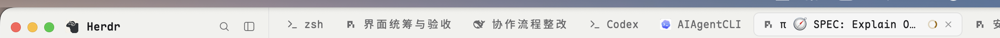

# Herdr UI Style（当前使用）

> 状态: v2.0 | 创建: 2026-11-18 | 最后更新: 2026-11-18 | 关联: layout/agents-order.json, tokens/

这个仓库记录 **Herdr 当前实际启用的界面风格**：

- 布局：`agents-order`（当前 active layout）
- 主题：未显式指定 → 按外观使用内置 `paper`（浅色）/ `graphite`（深色）；当前系统为浅色
- 字体：Maple Mono NF CN（UI + 终端，连字关闭）
- 外壳：内置 `workspace-chrome / spaces / tabs / pane / workspace-status` mods

> 更正：此前归档的 `flockbook` 主题不是当前启用的风格，已从本仓库移除。




## 当前配置来源

| 项 | 值 | 来源 |
|---|---|---|
| layout | `agents-order` | `~/.config/herdr-app/shared.json` |
| theme | 未设置 → `paper`（Light）/ `graphite`（Dark） | settings.json 无 theme，layout 无 theme |
| 字体 | Maple Mono NF CN，`font_ligatures: false` | settings.json |
| 明暗 | 跟随系统（当前 Light） | macOS 外观 |

## 复现

```bash
cp layout/agents-order.json ~/.config/herdr-app/layouts/
herdr-app do layout.switch --name agents-order
```

字体（`~/.config/herdr-app/settings.json`）：

```json
{
  "ui_font": "Maple Mono NF CN",
  "font": "Maple Mono NF CN",
  "font_ligatures": false
}
```

如需固定明暗主题，可在 layout 或 settings 中显式指定：

```json
"theme": { "light": "paper", "dark": "graphite" }
```

## 布局指标

来自 `layout/agents-order.json` 的实测值：

| 区域 | 值 |
|---|---|
| 标题栏 | 无（`titlebar: none`） |
| 窗口控件偏移 | `[12, 16]` |
| 侧栏宽 | `268px`（可调 `44–480`） |
| 侧栏背景 | `chrome` |
| 品牌行 | `46px`（`workspace-chrome`） |
| 标签栏 | `42px` |
| 面板 | `368px`，默认隐藏（`280–900`） |
| 状态栏 | `28px` |
| 终端内边距 | `[14, 12]` |
| 分屏 | `gap 8`、`radius 10`、`border 1px`、头部 `30px` |
| 分隔线 | `1px border` |

## 配色（从当前界面采样）

| Token | 值 | 用途 |
|---|---|---|
| `canvas` | `#ffffff` | 终端/主内容背景 |
| `chrome` | `#f1f1ee` | 侧栏、标签栏底色 |
| `selected` | `#e0e0dd` | 当前 Space / 任务行 |
| `border` | `#e3e3e3` | 1px 分隔线、面板边框 |
| `text` | `#1b1b1e` | 主文字 |
| `muted` | `#69696b` | 次要文字 |
| `dim` | `#969698` | 时间、分支等弱化信息 |
| `accent` | `#668ce8` | 激活指示、品牌蓝 |
| 身份色 | `#52a69a` / `#d68659` / `#ec6a5e` / `#f4bf4f` / `#61c554` | Space 徽标、状态环 |

> `paper` / `graphite` 是 Herdr 内置主题，不是仓库里的 JSON 文件；以上颜色为当前浅色界面截图采样值，应用版本变化时可能有细微差异。

## 文件

```
layout/agents-order.json   当前使用的布局（风格的结构性来源）
tokens/tokens.json         采样 token（机器可读）
tokens/tokens.md           token 说明与采样方法
docs/style.md              当前风格的规则与反例
screenshots/               真实界面裁剪：窗口标题/标签栏、侧栏
```

## 说明

- 截图来自当前运行窗口的裁剪（标题栏 + 侧栏），**不含对话正文、本地路径与会话 ID**。
- 本仓库不包含 Herdr 应用本体与内置 mods 的源码。
- 文档、token 与截图：MIT（见 [LICENSE](LICENSE)）。
