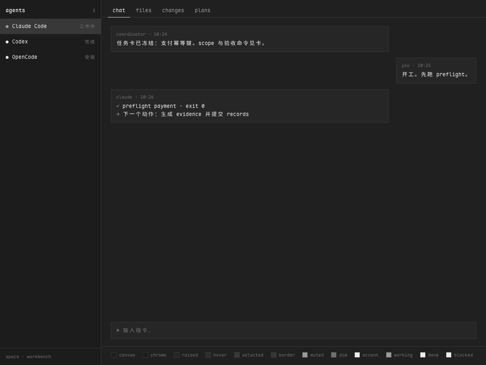

# Herdr Flockbook Style

> 状态: v1.1 | 创建: 2026-11-18 | 最后更新: 2026-11-18 | 关联: docs/style.md, tokens/, themes/

Herdr 工作台**当前使用**的视觉风格：单色优先、语义克制、终端字体驱动。
本仓库只收录当前在用的 `flockbook` 深色主题，不包含其它未启用的变体。



## 是什么 / 不是什么

- **是**：当前主题 JSON、语义色 token、布局与字体规范、可离线打开的预览页。
- **不是**：`flockbook` mod 的源码（通过独立 feed 安装，版权与分发归其作者）；也不包含未启用的浅色/mac 变体。

## 安装

1. 复制主题文件：

```bash
cp themes/flockbook.json ~/.config/herdr-app/themes/
```

2. 在 layout 中引用：

```json
"theme": "flockbook"
```

3. 字体：安装 **Maple Mono NF CN**，并在 `~/.config/herdr-app/settings.json` 中设置：

```json
{
  "ui_font": "Maple Mono NF CN",
  "font": "Maple Mono NF CN",
  "font_ligatures": false
}
```

4. 重启或切换 layout 生效。

## 设计原则

1. **单色优先**：界面结构只用亮度层级表达；颜色不承担装饰职责。
2. **五级表面**：`canvas < chrome < raised < hover < selected`，层级靠亮度差，不靠投影和描边堆叠。
3. **1px 边界**：分隔线 1px、无标题栏；窗口控件 18/22 偏移；边框色统一来自 `border` token。
4. **单一字体**：Maple Mono NF CN（UI + 终端），连字关闭；靠字重与亮度做层次。
5. **状态可读**：`working/done/blocked` 在同一灰阶体系内，状态靠位置、文案与图标表达；颜色不是唯一通道。
6. **克制的动效**：拖动让位 160ms、落位 100ms；不做装饰性动画。

## 语义 Token

| Token | 含义 | 值 |
|---|---|---|
| `canvas` | 主画布 | `#202020` |
| `chrome` | 侧栏/窗体底色 | `#1c1c1c` |
| `raised` | 浮起层（卡片/输入） | `#262626` |
| `hover` | 悬停 | `#2e2e2e` |
| `selected` | 选中 | `#383838` |
| `border` | 分隔线 | `#363636` |
| `muted` | 次要文字 | `#9a9a9a` |
| `dim` | 弱化文字 | `#707070` |
| `accent` | 强调/焦点 | `#ededed` |
| `working` | 运行中 | `#9a9a9a` |
| `done` | 完成 | `#ededed` |
| `blocked` | 受阻 | `#ededed` |

机器可读版本：`tokens/tokens.json`；逐项说明：`tokens/tokens.md`。

## 布局解剖

来自当前 layout 的实测值：

- 无标题栏（`titlebar: none`），窗口控件偏移 `[18, 22]`。
- 侧栏宽 `250px`，可拖拽范围 `220–320px`，背景 `chrome`，与主区之间 1px `border` 分隔线。
- 主区为纵向工作列，内层 stack 默认激活 chat；工作区面板：`files / changes / plans`。
- 侧栏行：agent 名称 + 状态点 + 标签；悬停显示改名入口，六点手柄拖拽排序。
- agent 菜单图标块：底色 `#1c1d21`、图标不透明白色（`tint: false`），保持单色一致。

## 文件

```
themes/flockbook.json   当前使用的主题（源文件，改风格从这里改）
tokens/                 语义 token（JSON + 说明）
preview/                离线预览页（纯静态）
screenshots/            预览截图
docs/style.md           更细的风格规则与反例
```

## 许可与归属

- 本仓库的文档、token 定义与预览页：MIT（见 [LICENSE](LICENSE)）。
- 主题 JSON：为我们的 Herdr 配置编写与维护，随本仓库 MIT 发布。
- `flockbook` mod 本体、图标与二进制分发物：不在本仓库范围内，版权归其作者。
- 未启用的浅色 / mac 语义色变体不在本仓库范围内。
